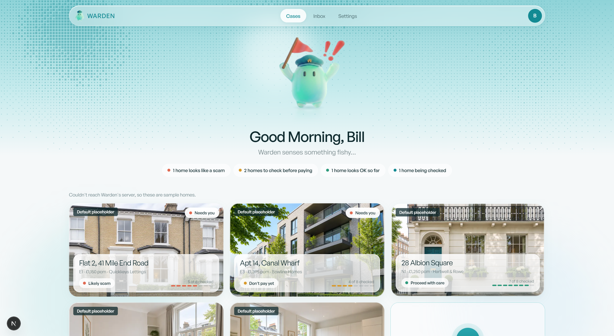
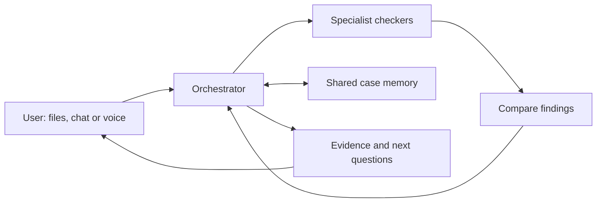

# Warden

**A clearer next step before you pay for a home.**

Finding somewhere to live in London can mean making expensive decisions from a few messages,
some photographs and a contract. For someone arriving in an unfamiliar city, urgency and
uncertainty make it difficult to know which questions to ask—or which answers to trust.

Warden helps you investigate a rental before handing over money. Share what the property
agent sent you, and a team of specialist AI agents checks the evidence. Warden explains the
concerns, asks focused follow-up questions and keeps track of what still needs verifying.
You can respond in chat or talk it through by voice.

Built for the **Imperial AI Hackathon, Autonomous Agents track, 14–15 November 2026**.

## Watch the demo

**The two-minute submission video will be linked here when available.** Judges can follow the
product walkthrough without installing the app. The local quickstart below is optional.

<!-- Add the public demo-video link above once available. No hosted app URL is available yet. -->


*Sample dashboard with fictional listings and illustrative statuses.*

## Three things that matter to the user

### See the evidence behind a warning

Warden's findings point back to
the messages or contract passages that support them, with source links for external checks.
The contract checker validates quoted text and combines language-model review with explicit
calculations and rules. Unsupported quotations are rejected rather than presented as evidence.

The user can distinguish missing information from a
specific suspicious request. Warden also records evidence that clears a check: verification
requires positive support, and a reassuring message alone is not enough.

### Answer the question that moves your case forward

Warden turns findings into practical questions: clarify who represents the landlord, ask for
agency details, or confirm when a payment is required. Questions relate to the evidence already
in the case, so the user has a concrete next step.

For example, when messages appear to demand payment before an in-person viewing, Warden asks
the user to confirm that interpretation before that payment warning can trigger an immediate
scam verdict. New evidence and answers feed back into the investigation.

### Talk it through with Warden

The voice interface lets the user discuss their case aloud. It uses the case's open questions
and records answers against them. When the call ends, the conversation and answers return to
the same case, where the relevant checks can run again.

This matters particularly when the user is stressed or on the move.
Chat and voice contribute to one investigation, with the evidence and outstanding questions
available on the case page. Live voice uses ElevenLabs and requires its credentials to be configured.

## How the agents work together

Four specialist checkers examine agency background, messages, emotional pressure and pricing,
and the tenancy contract. A cross-checker compares their reports for disagreements. An
orchestrator coordinates the investigation, chooses which checkers have enough information to
run, and brings their findings back to the user through targeted questions and explanations.



The agents return structured reports to a shared case; they do not independently message the
user. When evidence changes, the orchestrator reruns the affected checkers.
This gives the system a continuing task: gather evidence, resolve uncertainty and update its advice.

The interface keeps **risk** and **verification progress** separate. The gauge shows a category,
including neutral “Unknown risk” when evidence is insufficient. The progress bar reflects
weighted verification, so completing an analysis does not automatically make it 100%. The best
outcome is **“No red flags remaining”**, never a guarantee that a property is safe.

## What we tested

We exercised the initial analysis round on **40 synthetic cases**, including suspicious,
genuine and unresolved situations, using real model calls and controlled external-service
responses. This is a development evaluation, not a real-world accuracy benchmark, and is documented in
[evaluation results](backend/eval/RESULTS.md).

## Try it locally

You need Python 3.12+, Node.js, `uv` and `pnpm`. For a fresh checkout, copy
[`.env.example`](.env.example) to `.env`, add your LLM credentials and set
`DEFAULT_AGENT_MODE=real`. Configure Linkup and Companies House keys for live external checks.
The default `stub` mode replays fixture reports; it does not perform live verification.

Start these in separate terminals, each beginning at the repository root:

```bash
# Terminal 1: API
cd backend
uv sync --locked
uv run uvicorn app.api.main:app --port 8000
```

```bash
# Terminal 2: web app
cd web
pnpm install --frozen-lockfile
pnpm dev
```

Open [localhost:3000](http://localhost:3000) and choose **New case**. Voice configuration is
described in [`web/.env.local.example`](web/.env.local.example). MongoDB storage is optional;
the default in-memory store loses cases when the API restarts. The dashboard's five sample
cards currently open one shared demo case, so use a new case to test actual analysis.

## Scope and next steps

This is a hackathon prototype. It reads chats, screenshots, emails and documents, and supports
live voice conversations. Uploaded audio transcription and video analysis remain unfinished.
The integrated contract checker requires one readable contract; selecting and comparing uploaded
revisions is not implemented. Broader evaluation and completing these workflows are next steps.

## Team and developer documentation

Built by [Danny](https://github.com/dannybud19), [Georgi](https://github.com/georrous37),
[Bill](https://github.com/BillTheTsar) and [Audrey](https://github.com/audrey17leo).

For implementation and setup details, see the [system overview](CLAUDE.md),
[architecture](docs/architecture.md), [web documentation](web/README.md),
[upload formats](backend/app/intake/README.md) and [contract checker](backend/app/agents/contract_checker/README.md).
Contributors should read [AGENTS.md](AGENTS.md) and the [workstreams](docs/workstreams.md).
